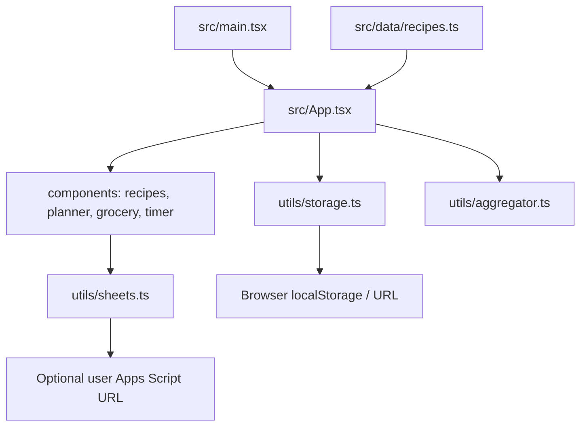

# Architecture

## Summary

Wajba is a client-rendered React application built and served by Vite. `App.tsx` composes the feature views, keeps shared state, and delegates persistence and derived grocery calculations to utility modules.

## Main Modules

| Module | Responsibility |
|---|---|
| `src/main.tsx` | Mount React under `#root` |
| `src/App.tsx` | URL-based landing/dashboard routing, shared state, navigation, and handlers |
| `src/components/` | User-facing views and modals |
| `src/pwa/` | Platform detection, install state, help/fallback flows, and service-worker source |
| `src/components/Pwa*.tsx` | In-flow install promotion, persistent recovery action, and installation help dialog |
| `src/data/recipes.ts` | Bundled runtime recipe catalog |
| `src/utils/storage.ts` | `localStorage`, seed data, shared-plan URL decoding/encoding, pantry and backup state |
| `src/utils/aggregator.ts` | Convert planned recipes into normalized grocery items and subtract compatible pantry quantities |
| `src/utils/sheets.ts` | CSV generation/download and optional remote POST |

## Data / Control Flow

1. `src/main.tsx` mounts `App`.
2. `/` renders the public landing page; `/dashboard` opens the schedule as the dashboard home, while `/dashboard/recipes` and the other tab routes render the remaining dashboard views.
3. Dashboard navigation stays in the header on larger screens and uses a fixed mobile bottom bar with a secondary-destination menu on smaller screens.
4. `App` loads language, theme, plans, favorites, votes, custom recipes, grocery state, and timers from browser storage.
5. `App` combines custom recipes with `INITIAL_RECIPES` from `src/data/recipes.ts`.
6. Planner views update weekly/monthly plans; the aggregator derives grocery items from assigned recipe IDs and servings.
7. UI actions save updated state back to `localStorage`; the planner starts empty, and its clear actions target the current local week or displayed month without deleting unrelated schedule periods.
8. Family sync actions encode a weekly plan into a URL, download files, or send a JSON payload to a user-provided Apps Script URL.

## PWA Installation

`PwaProvider` registers the production service worker, captures Chromium's install prompt when available, detects standalone launches, and persists dismissal/recovery state. The UI keeps a transient in-flow promotion separate from a persistent install/recovery action in the landing header and dashboard navigation. Android WebViews receive an external-browser intent plus a copyable URL fallback; iOS WebViews receive Safari/Add to Home Screen guidance because the host controls whether an external browser can be opened.

The worker precaches the application shell and static PWA assets, uses network-first navigation fallback, and deliberately excludes recipe data, API/auth routes, downloads, and other user/data endpoints from caching.

## Diagram

## External Services

- Optional Neon Auth Google sign-in: `src/auth/client.ts` and `src/components/AccountPanel.tsx`. Login does not upload device data automatically.
- Explicit account cloud backup/restore: `api/backup.ts` verifies JWT signatures and issuer, checks the account exists, and scopes every query to its subject. `public.wajba_backups` stores one JSON backup per account. Restore validates data and asks before replacing local state.
- Persistent family groups: `api/groups.ts` checks Google/Neon sessions and active membership for shared plans. `neon/001_family_groups.sql` defines groups, members, and invitation attempt limits. Invitations use random 10-character codes, expire after 30 days, and can be rotated or revoked without ending existing memberships. Owners can remove members; removed members cannot rejoin that group. Other members can leave.
- `FamilyGroups.tsx` lists groups and refreshes shared data each minute while visible. Publishing explicitly sends the weekly plan and only referenced custom recipes; applying validates and confirms replacement of the local week. Imported custom recipes receive fresh IDs to preserve existing recipes. Revision checks reject conflicting publishes. Invitation URLs use a fragment, retained in session storage through Google login. Snapshot links remain separate, require confirmation, and do not create memberships.
- `DATABASE_URL` and `NEON_AUTH_BASE_URL` are server configuration. `VITE_NEON_AUTH_URL` is the public Auth URL. Vite alone does not serve the Vercel API.
- Neon project: `winter-rice-52882717`, main branch `br-polished-mountain-b9wf1678`, AWS Frankfurt. Own Google OAuth client is connected and published for all Google users. Production runs on Vercel at https://wajjba.vercel.app.

- Google Apps Script Web App URL, optional and user-supplied.
- Unsplash/image URLs referenced by recipe data.
- Google Fonts loaded by `index.html`.
- `Unknown / verify`: whether Gemini is used in a separate runtime.

## Risks / Coupling

- Plans store recipe IDs; changing IDs can orphan saved plans.
- Browser storage is origin-scoped and has no server backup unless the user exports/syncs data.
- Pantry stock is explicitly maintained by the user; checking a grocery item never consumes pantry stock.
- Backup restore validates before replacement and excludes transient active timers.
- Google Sheets sync uses `fetch` with `no-cors`, so the client cannot inspect the remote response.
- `recipes_data.json`, `public/recipes_data.json`, generated JSON, and `src/data/recipes.ts` can drift; the runtime currently reads only the TypeScript catalog.
